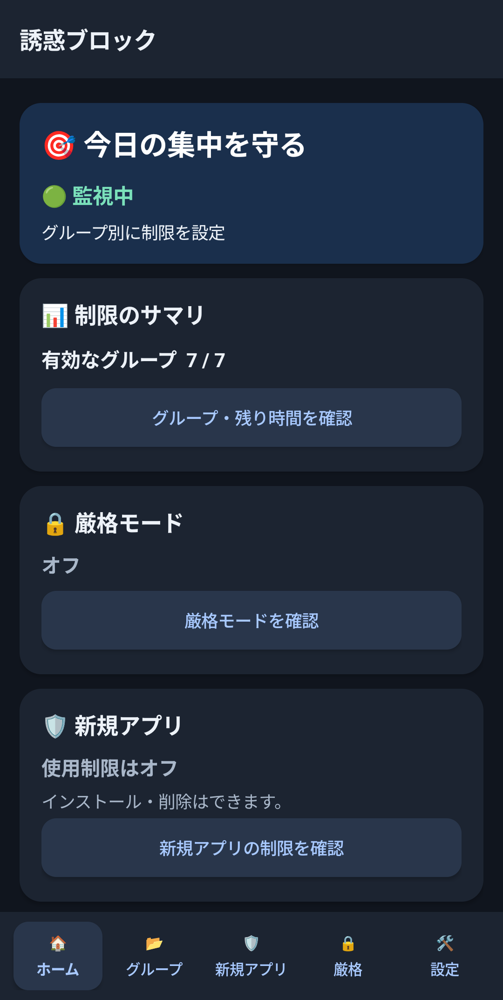
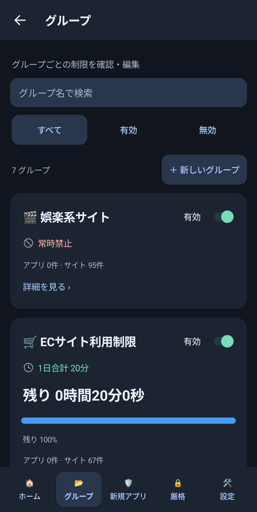
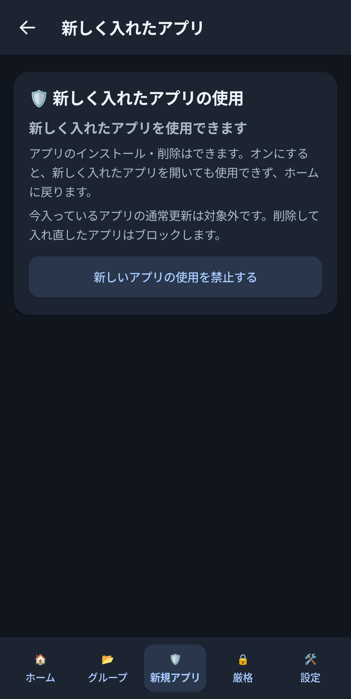
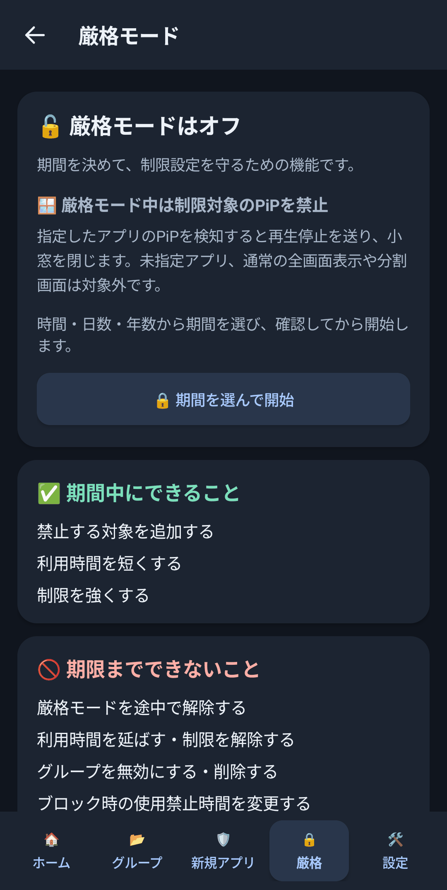
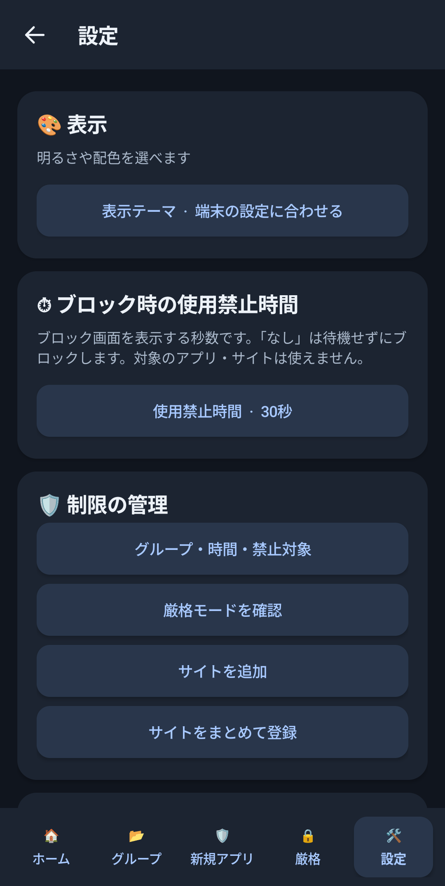

<div align="center">


# 誘惑ブロック

**使いすぎを止めて、集中したい時間を守る。**

アプリとWebサイトの利用時間を、グループごとにまとめて管理するAndroidアプリ。


[画面イメージ](#画面イメージ) · [できること](#できること) · [使い始める](#使い始める) · [ビルドとテスト](#ビルドとテスト)

</div>

---

動画アプリと動画サイトをひとつのグループにして、**合わせて1日30分まで**。時間を決めずに使いたくないものは、**常時禁止**に。誘惑ブロックは、自分で選んだアプリ・サイトにルールを設定し、日々の使いすぎを抑えるためのアプリです。

## 画面イメージ

ホームで今日の状況を確認し、グループ・新規アプリ・厳格モードをそれぞれの画面で管理します。画像はアプリ部分のみを掲載しています。

<table>
  <tr>
    <th>🏠 今日の状況</th>
    <th>📂 グループで管理</th>
    <th>🛡️ 新規アプリの制限</th>
  </tr>
  <tr>
    <td align="center"></td>
    <td align="center"></td>
    <td align="center"></td>
  </tr>
</table>

<table>
  <tr>
    <th>🔒 ルールを守る厳格モード</th>
    <th>🛠️ 待機時間・表示の設定</th>
  </tr>
  <tr>
    <td align="center"></td>
    <td align="center"></td>
  </tr>
</table>

## できること

| 機能 | 内容 |
| --- | --- |
| **アプリとサイトをまとめる** | アプリとWebサイトを同じグループへ登録し、グループ全体の1日の合計利用時間を管理 |
| **ルールを使い分ける** | 1日の時間上限・常時禁止・一時無効化をグループごとに設定 |
| **ブロック後にひと呼吸** | 待機時間を0・5・10・30・60・120・150・180秒から選択。初期値は30秒 |
| **厳格モード** | 指定期間中は制限の緩和や待機時間の変更を拒否 |
| **新規アプリの使用制限** | 有効にしたあとにインストールしたアプリの使用を制限 |
| **PiPへの対策** | 厳格モード中、制限対象アプリのピクチャーインピクチャー利用に対処 |
| **見やすい表示** | ホームに利用状況をまとめ、ライト／ダーク表示を切り替え |

### 制限するのは、自分で指定した対象

アプリ・サイトは利用者が明示的に指定します。**検索語に「YouTube」「漫画」「ゲーム」などが含まれるだけでは、娯楽利用としてブロックしません。**

- サイトの判定は、主にChrome／Braveの確定したURLに基づきます。サイトの制限は、ブラウザ自体のアプリ制限とは独立して適用します。
- 未対応ブラウザも、アプリとして指定していなければ一律に遮断しません。
- Google検索・Geminiなどの共通パッケージは、識別できた画面のルールだけを適用します。不明な画面をGoogle検索と決めつけません。
- 別のアプリ・ウィンドウへ移った場合は、先に始まったブラウザの遅延遮断を取り消します。

「新規アプリの使用制限」を有効にした場合は、そのルールも適用します。また、制限対象を開いて**すでに開始した全画面待機**は、設定された時間だけ継続します。

## 使い始める

1. [ビルドとテスト](#ビルドとテスト)の手順でAPKを作成し、Android端末へインストールします。
2. Androidの設定から、ユーザー補助サービス「誘惑ブロック」を有効にします。
3. 「グループ」で対象のアプリ・サイトを登録し、1日の時間上限や常時禁止を設定します。
4. 「設定」でブロック後の待機時間と表示を調整します。
5. 必要に応じて「新規アプリ」の制限や、期間を指定した「厳格モード」を有効にします。

新規インストール時の基本グループは**1日10分**です。自分の用途に合わせて対象と時間を確認してください。厳格モードを始める前に、必要なアプリが使えることと、待機時間を確認してください。

### 対応環境

| 項目 | 対応範囲 |
| --- | --- |
| OS | Android 8.0以上（API 26+） |
| サイトの詳細監視 | 主にChrome／Brave |
| 開発時の実機検証 | Pixel／Redmiが中心 |
| このリポジトリ | Android版のみ |

一般的なAndroid APIを使用しており、特定メーカー専用ではありません。ただし、すべての機種・OS・ブラウザでの動作を保証するものではありません。

## 権限・保存するデータ

ユーザー補助サービスで表示中のアプリやブラウザの画面情報を参照し、制限と画面操作に使います。
新規アプリ制限のためにインストール済みパッケージと初回インストール時刻を参照します。
グループ設定、登録アプリ・ドメイン、利用時間、遮断回数、厳格モードの期限、診断用状態を端末内に保存します。
遮断したドメインと時刻もローカルの設定に保存されます。

アプリはINTERNET権限を持たず、外部サーバーへのデータ送信や広告・解析SDKは含みません。
Androidの自動バックアップは無効です。詳細は [PRIVACY.md](PRIVACY.md) を参照してください。

### ユーザー補助との互換モード（任意）

ユーザー補助が有効な間は使えないアプリを、設定画面の対象一覧へ登録できます。
初期状態はオフです。従来のPayPay設定がある場合はそのまま引き継ぎます。
初期候補はPayPayですが、他のアプリも追加・削除できます。
全アプリの非互換性を自動判定する機能ではありません。実際に問題が出たアプリを登録してください。

- 登録したアプリの起動を検知すると準備画面を挟み、自分のユーザー補助を停止してから対象の起動画面を開き直します。
- 準備画面の自動表示がAndroidに制限された場合は、常駐通知または設定画面の「対象アプリを開く」を使います。
- 対象一覧にないアプリへの移動、画面ロック、判定失敗、連続5分経過で監視に復帰します。
- 登録済みアプリ同士の移動でも、5分の上限は延長しません。上限経過後は一度対象一覧の外へ移動するまで再停止しません。
- 既存の制限対象、対応ブラウザ、新規アプリの使用禁止対象を、互換モードで制限解除することはできません。
- 一時停止中はアプリ・Webサイトの遮断とPiP制御も止まります。厳格モードの期限・設定と累積使用時間は維持します。
- 他のユーザー補助サービスの設定は保持します。対象アプリのデータ消去や強制停止、支払い操作は行いません。

初回のみ、Androidの「使用状況へのアクセス」を許可し、ADB接続したPCで次を実行してください。

```bash
adb shell pm grant jp.personal.entertainmentguard android.permission.WRITE_SECURE_SETTINGS
```

Android 13以降では通知も許可してください。端末設定権限は通常のダイアログでは取得できません。
この機能は任意であり、Google Playでの配布対応とは別です。

停止した記録を先に保存し、監視サービスの再起動、アプリ更新、端末再起動後にも復帰を試みます。
アプリ全体の強制停止や端末設定権限の取り消し中には自動復帰を保証できません。
復帰できない場合は、端末のユーザー補助設定で「誘惑ブロック」をONにしてください。
アプリを再度開く際にも、保存された一時停止状態の復帰を試みます。

## 制限事項

- ユーザー補助の無効化、データ消去、アンインストールを完全に防ぐ仕組みではありません。Device Owner／MDMは使いません。
- Webサイトの詳細監視は主にChrome／Brave向けです。別ブラウザ、WebView、分割画面、メーカーの省電力制御などは個別検証が必要です。
- 再起動後、OS由来のネットワーク時刻が得られない場合は、厳格モードの解除が予定より遅れる場合があります。
- 他のブロックアプリの設定を自動で読み取る機能はありません。対象は自分で登録してください。
- ソース公開とGoogle Playでの配布・審査対応は別です。


## ビルドとテスト

JDK 17、Gradle 8.10.2、Android SDK Platform 35／Build Tools 35.0.0、Python 3を用意し、
`JAVA_HOME` と `ANDROID_HOME` を設定してください。GradleとJavaはPATHから実行できる必要があります。

```sh
bash scripts/dev.sh test-android
bash scripts/dev.sh build-android
```

ビルドは `assembleDebug` と `lintDebug` を実行します。初回は依存関係の取得にネット接続が必要です。
既にキャッシュがある場合は `GRADLE_OFFLINE=true bash scripts/dev.sh build-android` も使えます。
APKは `app/build/outputs/apk/debug/app-debug.apk` に生成します。

実機へ入れる場合は、接続先を確認したうえで明示的に指定してください。

```sh
adb devices -l
adb -s DEVICE_SERIAL install -r app/build/outputs/apk/debug/app-debug.apk
```

起動後、Androidの設定でユーザー補助サービス「誘惑ブロック」を有効にします。
新規インストールの基本グループは1日10分です。既存設定は更新時に引き継ぎます。
アプリIDは `jp.personal.entertainmentguard` です。同一署名のAPKでのみ既存アプリを上書き更新できます。
このリポジトリに署名鍵は含めていません。ビルドされるAPKは開発・検証用で、Google Play公開用ではありません。


<details>
<summary><strong>開発時の情報保護</strong></summary>


```sh
git config core.hooksPath .githooks
git add <変更したファイル>
python3 scripts/audit_public.py
```

コミット前フックはステージ済み内容の秘密情報・個人情報の代表的パターンを検査します。
既存コミットの確認には `python3 scripts/audit_public.py --ref HEAD` を使います。
自動検査には検出限界があるため、差分も確認してください。
端末IP、個人の設定バックアップ、未加工のスクリーンショット、実機ログ、署名鍵、ADB鍵はコミットしないでください。
README用のスクリーンショットは個人情報・システム表示を取り除き、監査スクリプトにハッシュを登録した画像だけを公開します。ロゴのSVGはアプリのベクターアイコンから作成しています。


</details>
