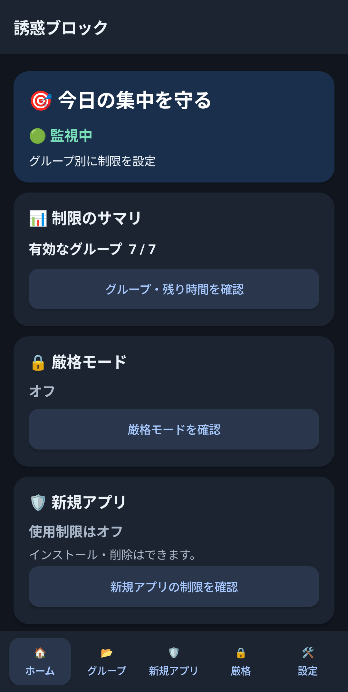
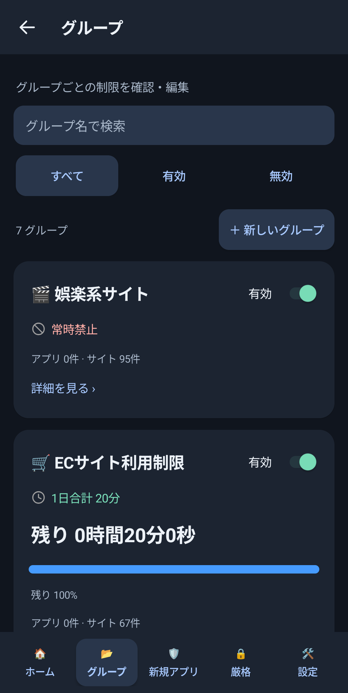
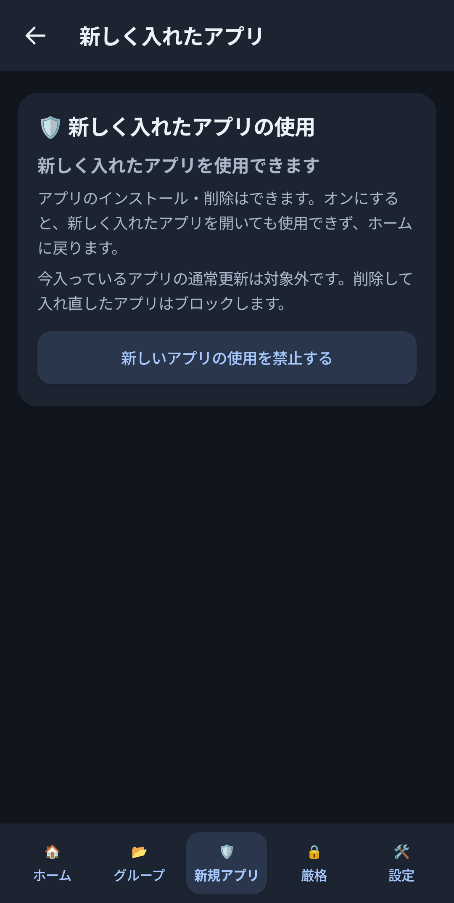
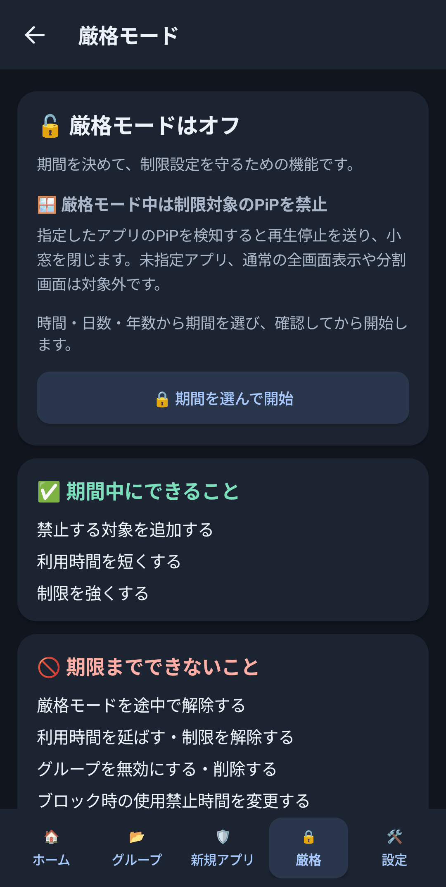
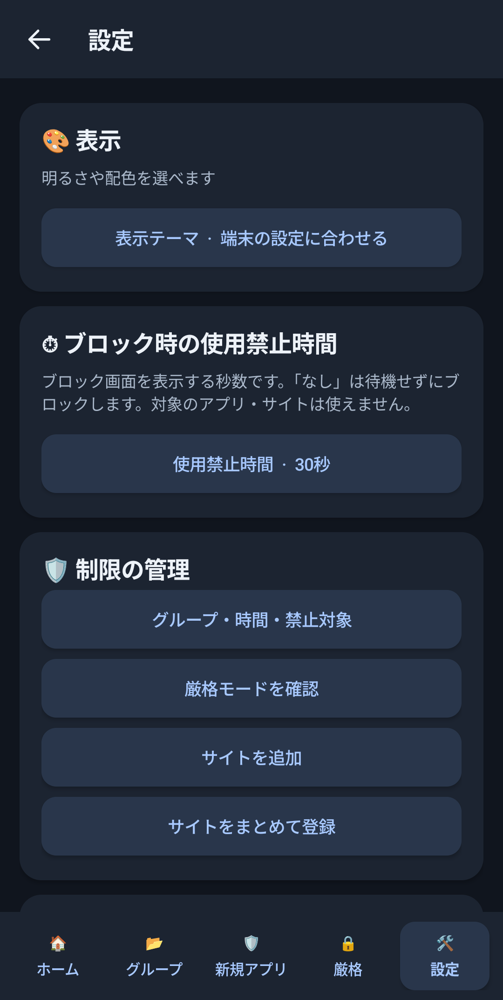

# 誘惑ブロック — Android

アプリとWebサイトの利用時間をまとめて管理する、Android向けのブロックアプリです。

## スクリーンショット

Pixel 10aで撮影したAndroid版の画面です。時計・通知バーとAndroidのシステム操作バーは取り除き、アプリ内メニューは残しています。

<p align="center">
  
  
  
  
  
</p>

## 制限対象の原則

制限するアプリ・サイトは利用者が明示的に指定します。
既知の娯楽アプリ・サイトという理由や、検索語・画面の文章だけで自動的に対象へ追加しません。
未対応ブラウザも、アプリとして指定していなければ一律には遮断しません。
Google検索・Geminiなどの共通パッケージは、識別できた画面のルールだけを適用します。
識別できない画面をGoogle検索と決めつけません。
別アプリ・別ウィンドウへ移った場合は、先に始まったブラウザの遅延遮断を取り消します。

登録済みサイトの制限は、ブラウザ自体のアプリ制限とは独立して適用します。
「新規アプリの使用制限」を有効にした場合は、その指定ルールによる新規インストール制限が適用されます。
制限対象を開いて既に開始した全画面待機は、設定された時間だけ継続します。

## 機能

- アプリとサイトを混在させたグループごとの、1日の合計時間・常時禁止・一時無効化
- ブロック時の待機時間：0・5・10・30・60・120・150・180秒（初期値30秒）
- 期間を指定する厳格モード。期間中は制限の緩和や待機時間の変更を拒否
- 新規インストールアプリの使用制限、厳格モード中の制限対象アプリに対するPiP対策
- ライト／ダーク表示、ホームのサマリとグループ管理
- Chrome／Braveの確定したURLに基づくサイト判定。検索キーワードだけで娯楽利用と判定しません

一般的なAndroid APIを使っており、特定メーカー専用ではありません。
最小対応はAndroid 8.0（API 26）、target／compile SDKは35です。
Pixel／Redmiでの開発時検証が中心で、すべての機種・OS・ブラウザでの動作を保証するものではありません。

## ビルドとテスト

JDK 17、Gradle 8.10.2、Android SDK Platform 35／Build Tools 35.0.0、Python 3を用意し、
`JAVA_HOME` と `ANDROID_HOME` を設定してください。GradleとJavaはPATHから実行できる必要があります。

```sh
bash scripts/dev.sh test-android
bash scripts/dev.sh build-android
```

ビルドは `assembleDebug` と `lintDebug` を実行します。初回は依存関係の取得にネット接続が必要です。
既にキャッシュがある場合は `GRADLE_OFFLINE=true bash scripts/dev.sh build-android` も使えます。
APKは `app/build/outputs/apk/debug/app-debug.apk` に生成します。

実機へ入れる場合は、接続先を確認したうえで明示的に指定してください。

```sh
adb devices -l
adb -s DEVICE_SERIAL install -r app/build/outputs/apk/debug/app-debug.apk
```

起動後、Androidの設定でユーザー補助サービス「誘惑ブロック」を有効にします。
新規インストールの基本グループは1日10分です。既存設定は更新時に引き継ぎます。
アプリIDは `jp.personal.entertainmentguard` です。同一署名のAPKでのみ既存アプリを上書き更新できます。
このリポジトリに署名鍵は含めていません。ビルドされるAPKは開発・検証用で、Google Play公開用ではありません。

## 権限・保存するデータ

ユーザー補助サービスで表示中のアプリやブラウザの画面情報を参照し、制限と画面操作に使います。
新規アプリ制限のためにインストール済みパッケージと初回インストール時刻を参照します。
グループ設定、登録アプリ・ドメイン、利用時間、遮断回数、厳格モードの期限、診断用状態を端末内に保存します。
遮断したドメインと時刻もローカルの設定に保存されます。

アプリはINTERNET権限を持たず、外部サーバーへのデータ送信や広告・解析SDKは含みません。
Androidの自動バックアップは無効です。詳細は [PRIVACY.md](PRIVACY.md) を参照してください。

## 制限事項

- ユーザー補助の無効化、データ消去、アンインストールを完全に防ぐ仕組みではありません。Device Owner／MDMは使いません。
- Webサイトの詳細監視は主にChrome／Brave向けです。別ブラウザ、WebView、分割画面、メーカーの省電力制御などは個別検証が必要です。
- 再起動後、OS由来のネットワーク時刻が得られない場合は、厳格モードの解除が予定より遅れる場合があります。
- 他のブロックアプリの設定を自動で読み取る機能はありません。対象は自分で登録してください。
- ソース公開とGoogle Playでの配布・審査対応は別です。

## 開発時の情報保護

```sh
git config core.hooksPath .githooks
git add <変更したファイル>
python3 scripts/audit_public.py
```

コミット前フックはステージ済み内容の秘密情報・個人情報の代表的パターンを検査します。
既存コミットの確認には `python3 scripts/audit_public.py --ref HEAD` を使います。
自動検査には検出限界があるため、差分も確認してください。
端末IP、個人の設定バックアップ、未加工のスクリーンショット、実機ログ、署名鍵、ADB鍵はコミットしないでください。
README用の画像は個人情報・システム表示を取り除いたものに限り、監査スクリプトに登録した画像だけを公開します。

Android版のみを管理するリポジトリです。
